# NYC 311 Service Request Analysis

**What drives slow resolution times for NYC 311 requests, by complaint type, agency, borough, and season?**

An end-to-end analysis of **3,655,042 NYC 311 service requests created in 2025**: a resumable API download, a bulk load into PostgreSQL, documented cleaning rules with tests, SQL analysis, charts, a Power BI dashboard, and a 14-day [demand forecast](#demand-forecasting) of daily request volume.

**Stack:** Python (pandas, requests, psycopg) · PostgreSQL · SQL · matplotlib · scikit-learn · statsmodels · pytest · Streamlit · Power BI

[live demo](https://nyc-311-dashboard-y8su.onrender.com/)

---

## Key findings

All numbers come from the SQL files in [`sql/analysis/`](sql/analysis/). [`outputs/findings.md`](outputs/findings.md) is generated from the query results by `src/findings.py`, so rerunning the script reproduces every number.

1. **The agency handling a request matters far more than borough or season.** Median resolution time ranges from **1.26 h (NYPD) to 7,845.19 h (EDC)** across the 15 agencies, compared with 4.03–15.18 h across boroughs and 4.01–14.00 h across seasons. NYPD handles **46.99%** of all requests (1,717,594), so it dominates the citywide median.
2. **The season pattern reverses once NYPD is separated out (a mix effect, or Simpson's paradox).** Across all requests, Winter is slowest (**14.00 h** median) and Summer fastest (**4.01 h**). For all agencies except NYPD, **Summer is slowest (73.38 h)** and Winter fastest (56.55 h). Winter's overall median is high because NYPD's fast requests are a smaller share in Winter (42.77% vs 48.82% in Summer), and NYPD itself is slower in Winter (1.68 h vs 1.05 h).
3. **Borough differences depend on the complaint type.** Compared with the citywide median for the same type, the Bronx is slower for Illegal Parking (**1.52x**), Noise - Residential (1.48x) and Abandoned Vehicle (1.44x), but faster for HEAT/HOT WATER (**0.85x**). Manhattan is faster for Illegal Parking (0.68x) but slower for UNSANITARY CONDITION (1.52x).

Overall: median **6.61 h**, 90th percentile **409.46 h**, mean **237.29 h**. **91.48%** of requests closed within 30 days.

---

## Live dashboard (Streamlit)

**Live dashboard:** https://nyc-311-dashboard-y8su.onrender.com/ (free Render plan: the first visit after a quiet period takes about a minute to wake up; [deploy steps](docs/deploy_render.md))

An interactive web app in [`app/`](app/) with five pages: overview metrics, a resolution-time explorer (filter by agency, borough and season), Kaplan-Meier survival curves with an agency selector, the prediction model's results, and the 14-day demand forecast (actual vs. forecast with 80% intervals, model comparison, per-agency results and staffing). It reads only ~0.2 MB of pre-aggregated files built by `analysis/build_app_data.py` and `forecast/build_forecast_app_data.py`, never the 3.6M raw rows or the database, so it needs no credentials. Run it locally with `streamlit run app/streamlit_app.py`.

---

## Dashboard screenshots

The dashboard is saved as a **Power BI Project** in [`powerbi/`](powerbi/): plain-text files (data model in TMDL, pages in JSON) that hold no data, generated by `src/build_powerbi_project.py`. Open `powerbi/NYC311.pbip` in Power BI Desktop and click **Refresh** to load the CSVs. [`docs/powerbi_guide.md`](docs/powerbi_guide.md) explains every part, and how to build it by hand.

<!-- Save each page as a PNG in outputs/dashboard/ using these file names. -->

### Overview
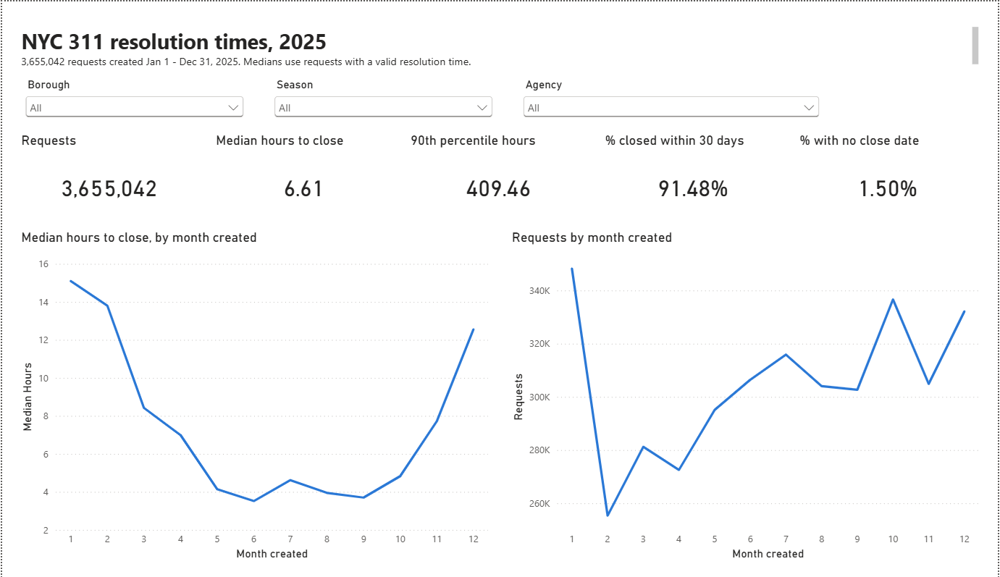

### Agencies
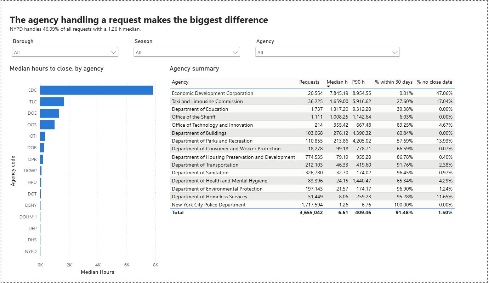

### Complaint types
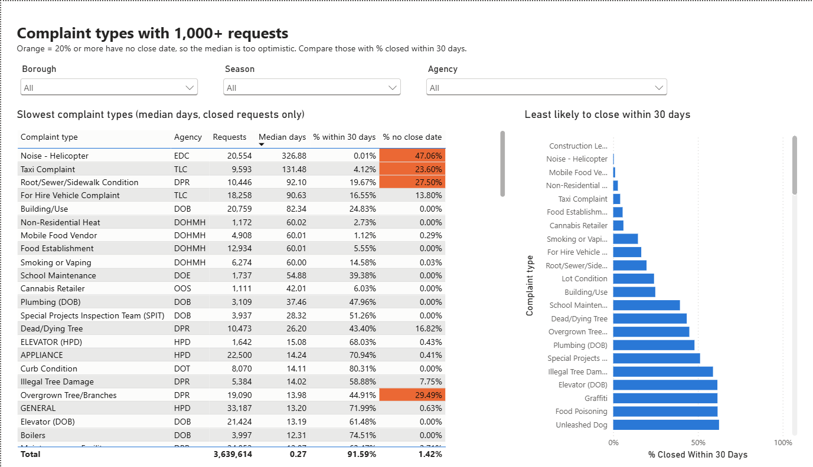

### Borough × complaint type
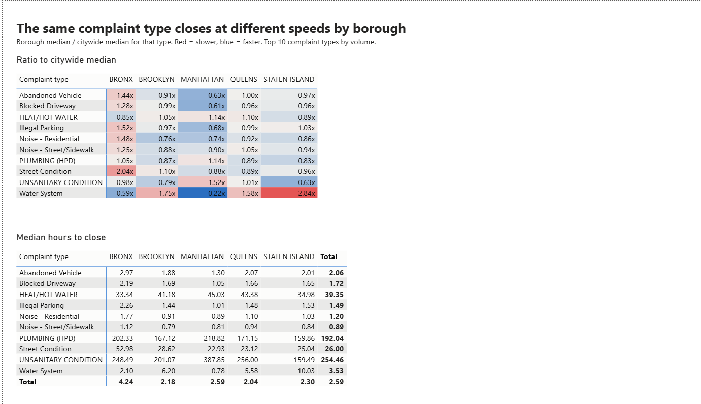

### Season mix effect
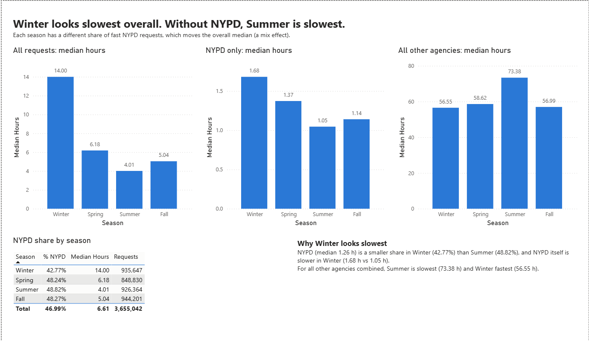

### Data and method notes
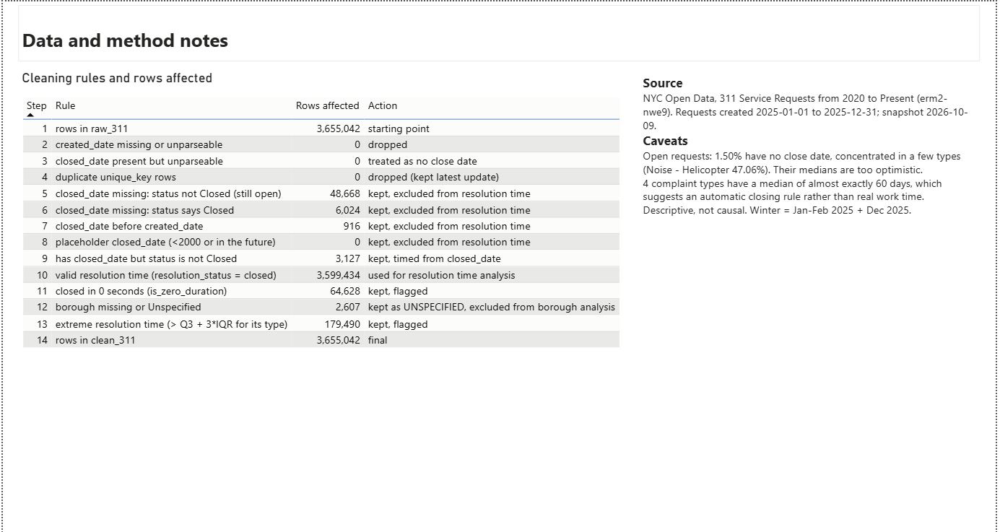

---

## Charts (Python)

| | |
|---|---|
| 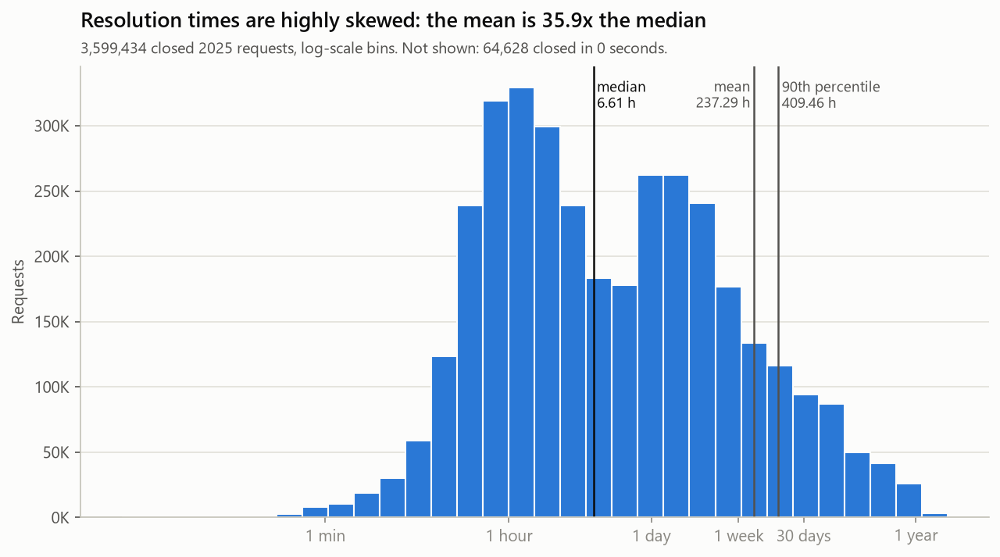 | 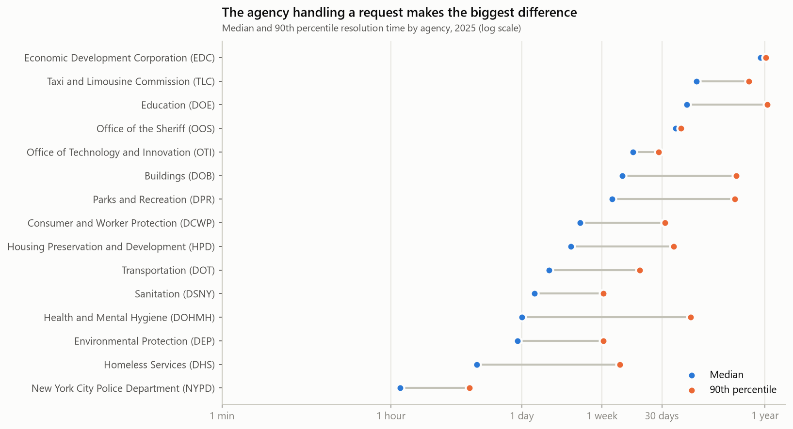 |
| 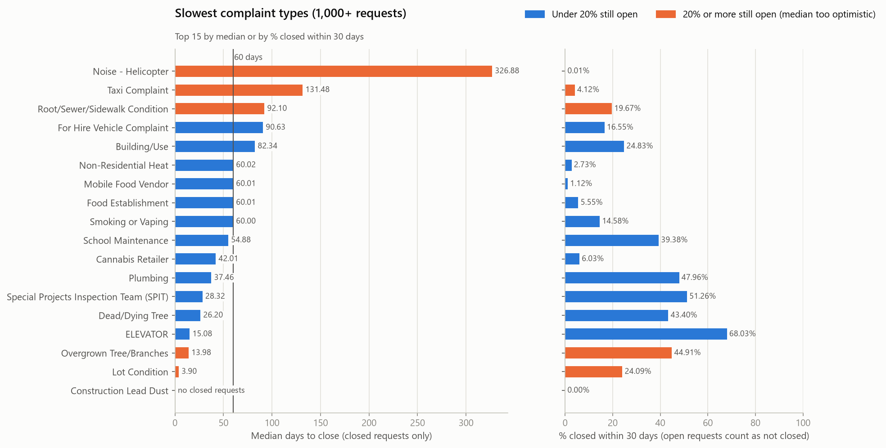 | 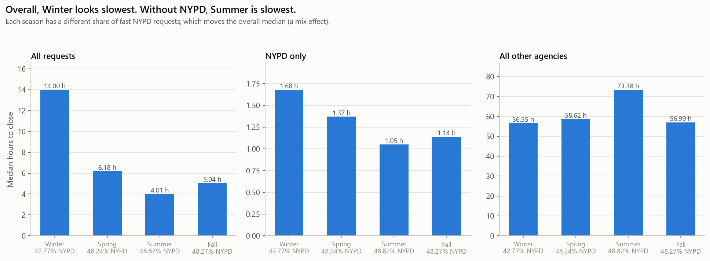 |
| 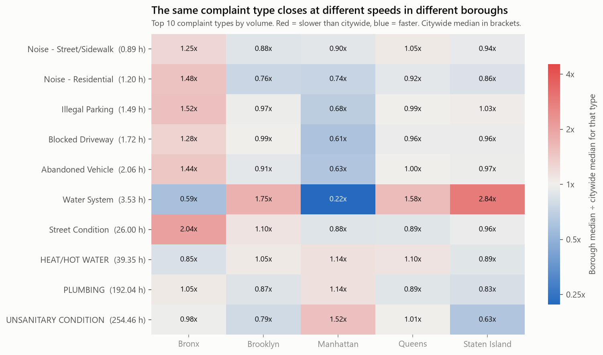 | 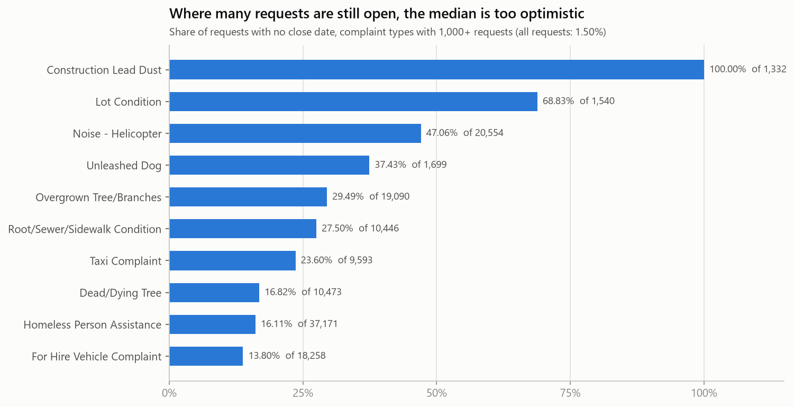 |

---

<!-- ADVANCED-ANALYSIS:START (generated by analysis/summary.py; edit that script, not this text) -->
## Advanced Analysis

Three follow-up analyses in [`analysis/`](analysis/), with every number in [`results/results.md`](results/results.md):

- **Survival analysis (lifelines).** Instead of dropping the 48,668 still-open requests, they're treated as *censored* (open for at least as long as observed). The overall median moves from 6.61 h to 7.12 h, but the bias is concentrated: DPR's median rises from 213.86 h to 381.82 h (+78.54%). In a Cox model (concordance 0.7704), agency has by far the largest effects, though the proportional hazards assumption fails for 22 of 29 covariates, so its hazard ratios are read as average effects.
- **Statistical testing.** Kruskal-Wallis effect sizes (epsilon-squared): agency 0.5537, season 0.0066, borough 0.0049. Every p-value is below 1e-300 with 3,599,434 rows, so the effect size is what matters: agency explains 83.8x more than the next factor. Bootstrapped 95% CIs (1,000 resamples) for each agency's median are narrow for large agencies; the widest is DOE (1,149.19 - 1,514.26 h, 1,737 requests).
- **Prediction (scikit-learn).** Predicting closure within 7 days from information known at filing, trained on Jan-Sep and tested on Oct-Dec 2025: gradient boosting reaches ROC AUC 0.9556 vs 0.5000 for a majority-class baseline. Top features by permutation importance: complaint_type (0.2755), agency (0.0671), borough (0.0043); agency and complaint type shuffled together drop AUC by 0.4597.

| | |
|---|---|
| 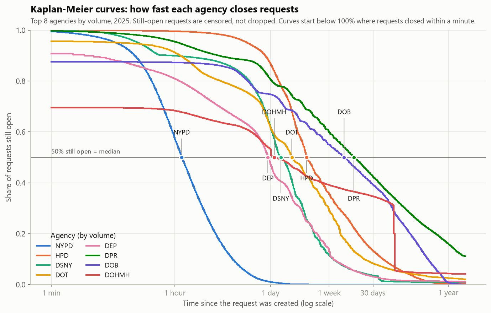 | 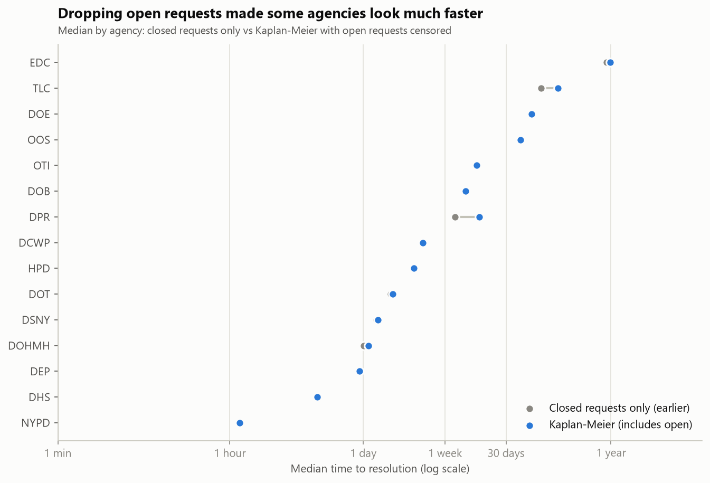 |
| 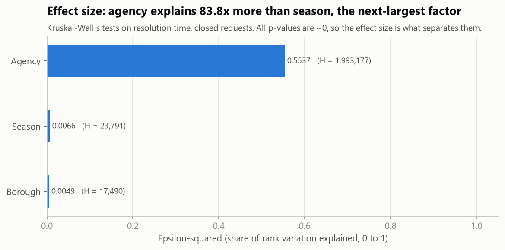 | 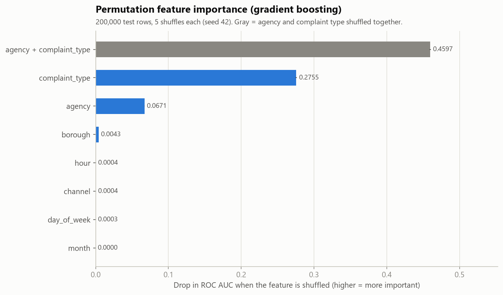 |

Reproduce: `python analysis/survival.py`, `python analysis/stats_tests.py`, `python analysis/prediction.py`, then `python analysis/summary.py`.
<!-- ADVANCED-ANALYSIS:END -->

---

<!-- DEMAND-FORECASTING:START (generated by forecast/write_summary.py; edit that script, not this text) -->
## Demand Forecasting

Framed like supply-chain demand planning: forecast **daily 311 request volume 14 days ahead**, citywide and for the 5 busiest agencies, and turn the forecast into a staffing plan the way a planner turns a demand forecast into inventory. Code in [`forecast/`](forecast/); every number in [`results/forecast/forecast.md`](results/forecast/forecast.md); build log in [`BUILD_LOG.md`](BUILD_LOG.md); interactive version on the dashboard's **Forecast** page.

**Approach.**

- **Data** ([`sql/forecast/`](sql/forecast/)): 365 daily counts, built on a full calendar so a missing day can't hide. No missing or partial days and no outages. 29 outlier days in 10 episodes (holidays, a cold snap, the December snow, a batch load) were kept, because a forecast should be judged on them. One Bronx location filing bursts of noise complaints (3.4% of the year) is measured with a same-day rule, so every result is also reported without it.
- **Baselines:** naive, seasonal naive (same weekday last week) and a 4-week same-weekday average.
- **Models:** Holt-Winters (statsmodels; add weekly season, damped trend, all history) and gradient boosting (scikit-learn; relative target, depth 4, learning rate 0.1) with day of week, month, US federal holidays, `lag_7`, `lag_14` and a 7-day mean. It uses a *direct* multi-step strategy: one model predicts day t+h from what was known on day t, so its own predictions are never fed back in.

**Backtest design.** Rolling origin: at each weekly cutoff a model gets only the days up to the cutoff and forecasts the next 14. 9 **validation** cutoffs (2025-08-13 to 2025-10-08) are used to tune settings and pick the model; 9 **test** cutoffs (2025-10-22 to 2025-12-17, the last 10 weeks of 2025) are only reported. The engine cuts the data at the cutoff before the model runs, and tests check that rewriting every value after the cutoff doesn't change a forecast.

**Results, citywide (MAE = average miss in requests per day):**

| Model | Validation MAE | Test MAE | Test RMSE | Test MAPE | Test MAE vs seasonal naive |
|---|---:|---:|---:|---:|---:|
| Naive (tomorrow = today) | 705 | 1,847 | 2,284 | 17.9% | +1.6% |
| Seasonal naive (same weekday last week) | 573 | 1,877 | 2,378 | 18.4% | +0.0% |
| 4-week same-weekday average | 527 | 1,533 | 1,868 | 14.9% | +18.3% |
| Holt-Winters | 531 | 1,745 | 2,177 | 17.4% | +7.0% |
| Gradient boosting (chosen) | 478 | 1,765 | 2,278 | 17.3% | +6.0% |

- Gradient boosting won validation (+16.5% MAE vs seasonal naive) and was chosen. On test it stayed ahead of seasonal naive (+6.0%), but the **4-week same-weekday average was best on test** (+18.3%). The validation weeks were calm, while the test weeks had the bursts, Thanksgiving, the snow and Christmas. Single lags copied events into the next week; averaging four weeks diluted them. Nothing was re-tuned after seeing this.
- Without the burst location, the chosen model's test MAE falls to 1,342 and MAPE to 13.9%.
- **80% prediction intervals** (from the model's own past errors, using only windows finished before each cutoff) covered 88.1% of validation days but only 40.5% of test days. They were calibrated on calm months, so they were far too narrow for December.

**Per agency** (approach picked on each agency's own validation windows; easiest to hardest):

| Agency | Chosen | Test MAPE | Test MAE vs seasonal naive | Short days: roster to forecast | Short days: roster to P90 |
|---|---:|---:|---:|---:|---:|
| DOT | 4-week same-weekday average | 19.7% | +12.2% | 44% | 15% |
| NYPD | 4-week same-weekday average | 20.1% | -4.7% | 38% | 20% |
| DEP | Holt-Winters | 20.4% | +28.2% | 52% | 13% |
| HPD | Gradient boosting | 31.2% | +3.0% | 43% | 16% |
| DSNY | Gradient boosting | 39.5% | +4.4% | 37% | 13% |

DOT is easiest because its demand follows the working week. DSNY is hardest: the December snow drives most of its error. Rostering to the top of the 80% interval (P90, the staffing version of safety stock) cut short-staffed days from 37-52% to 13-20%. That is still above the 10% a P90 plan should give, for the same reason the intervals under-covered.

| | |
|---|---|
|  |  |

**Limitations.**

- **One year of data.** Each season and each holiday happens once, so yearly seasonality (HPD's heating season, DEP's summer) can't be learned, and holiday effects are averaged across very different holidays.
- **No external drivers.** No weather, events or school calendar. Snow, heavy rain and heat caused the biggest misses, and only a forecast of the weather itself could anticipate them.
- **Short test period.** 9 overlapping 14-day windows in one unusual stretch of the year. The results show how the methods behave in a volatile period, not a stable long-run accuracy.
- **Requests, not workload.** A request's effort varies by type, and there's no data on requests handled per staff shift, so staffing is expressed in requests per day.

**What I'd do next.**

1. Add 2023-2024 data from the same API, so the models can learn the heating season, summer and each holiday.
2. Add weather forecasts (snow, rain, temperature) as features: they are known in advance, like holidays.
3. Make lag features robust: use the median of the last 4 same weekdays instead of single lags, so one event isn't copied forward.
4. Choose models on a validation period that includes volatile weeks (needs the extra years), and consider an average of the 4-week baseline and the models.
5. Recalibrate the intervals by season, or use conformal prediction over a longer history, and track their coverage every week.

Reproduce: `python forecast/daily_series.py`, `python forecast/baselines.py`, `python forecast/evaluate_models.py`, `python forecast/agencies.py`, `python forecast/build_forecast_app_data.py`, then `python forecast/write_summary.py`.
<!-- DEMAND-FORECASTING:END -->

---

## Data

- **Source:** NYC Open Data, [*311 Service Requests from 2020 to Present*](https://data.cityofnewyork.us/Social-Services/311-Service-Requests-from-2020-to-Present/erm2-nwe9) (Socrata dataset `erm2-nwe9`), via the API at `https://data.cityofnewyork.us/resource/erm2-nwe9.json`
- **Scope:** requests **created** 2025-01-01 through 2025-12-31 (first: 2025-01-01 00:00:12, last: 2025-12-31 23:59:28)
- **Snapshot:** downloaded 2026-10-11. The latest close date in the data is 2026-10-09 13:54:53, so every request had at least 9 months to close.
- **Fields:** API field names were confirmed from the dataset's metadata. The web UI now labels `complaint_type` as "Problem" and `descriptor` as "Problem Detail", but the API names are unchanged.

### Row counts

| Stage | Rows |
|---|---:|
| API count for 2025 | 3,655,042 |
| Downloaded and loaded into `raw_311` | 3,655,042 (0 duplicates) |
| In `clean_311` (no rows needed dropping) | 3,655,042 |
| With a valid resolution time (used for medians) | 3,599,434 |
| Complaint types / agencies | 193 / 15 |

---

## Methods

### 1. Ingestion ([`src/download.py`](src/download.py), [`src/load_raw.py`](src/load_raw.py))
- Downloads from the Socrata API with `$limit`/`$offset`, `$where` on `created_date`, and `$order=unique_key`, **one day at a time**. Paging the whole year with `$offset` timed out on the live API (over 5 minutes per page); one-day windows return in a few seconds.
- **Resumable:** each page is written to a temporary file and then renamed, so a crash never leaves a half-written page. A rerun skips pages already on disk. Retries with exponential backoff on timeouts, HTTP 429 and 5xx.
- Optional Socrata app token from `.env`. The database connection string lives only in `.env` (git-ignored).
- Loads all pages into an all-TEXT raw table with PostgreSQL **`COPY`** (3.66M rows in about 94 seconds), then checks the row count against the API's count.

### 2. Cleaning ([`src/cleaning.py`](src/cleaning.py), [`src/clean.py`](src/clean.py))
Rows are **flagged, not deleted**, so every rule can be counted and reversed in a query. Counts are stored in the `cleaning_report` table.

| Rule | Rows | Handling |
|---|---:|---|
| Unparseable `created_date` | 0 | would be dropped |
| Duplicate `unique_key` | 0 | would be dropped (keep latest update) |
| No close date, status not Closed (still open) | 48,668 | kept; no resolution time |
| No close date, but status says Closed | 6,024 | kept; no resolution time |
| Closed before created | 916 | kept; no resolution time |
| Placeholder close date (before 2000 or in the future) | 0 | kept; no resolution time |
| Has close date but status not Closed | 3,127 | kept; timed from `closed_date` |
| Closed in 0 seconds | 64,628 | kept; flagged `is_zero_duration` |
| Borough missing or "Unspecified" | 2,607 | `UNSPECIFIED`; excluded from borough analysis only |
| Extreme time (above Q3 + 3×IQR **within its complaint type**) | 179,490 | kept; flagged `is_extreme` |

- **Resolution time** = `closed_date − created_date` in hours, only for valid closures.
- **Season** uses meteorological seasons based on the created date (Winter = Dec–Feb, etc.).
- **Tests:** 7 pytest tests cover each cleaning function ([`tests/test_cleaning.py`](tests/test_cleaning.py)).

### 3. Analysis ([`sql/analysis/`](sql/analysis/))
One question per file: overview, complaint type, agency, borough, season, slowest types (≥1,000 requests), complaint type × borough, a season-mix check, and the distribution.

- **Why medians:** resolution times are extremely right-skewed. The mean (237.29 h) is 35.9× the median (6.61 h), because a small number of requests take months. The median describes a typical request, and the 90th percentile describes the slow tail.
- **Requests still open:** they have no resolution time, and they're the slowest ones, so leaving them out makes medians look too fast (right-censoring). Every result reports **% with no close date** next to the median, plus **% closed within 30 days**, which counts open requests as "not closed" and so isn't affected by this. Overall only 1.50% of requests are open, but for some types it's much higher (Noise - Helicopter: 47.06%).

### 4. Verification
- 36 headline numbers were recomputed independently in pandas from the cleaned CSV, and all matched the SQL.
- The Power BI measure logic was checked against the SQL results (208 values).
- `findings.py` refuses to write a finding whose wording ("slower", "reverses", ...) the data no longer supports.

---

## Limitations

- **Descriptive, not causal.** Differences reflect complaint mix, agency processes and staffing, and those effects aren't separated except in the season-mix check.
- **Open requests** (1.50% overall, concentrated in a few types) make medians too optimistic for those types. Use % closed within 30 days for them.
- **Close dates may reflect administrative rules rather than real work.** Four DOHMH complaint types close at almost exactly 60 days (medians 1,440.03–1,440.39 h), which suggests an automatic closure. The data can't confirm the process.
- **"Closed" means closed in the system,** not necessarily that the problem was fixed.
- **Timestamps are NYC local time with no time zone,** so durations that cross a daylight-saving change are off by one hour.
- **"Winter" combines Jan–Feb 2025 and Dec 2025,** not one continuous winter.
- **One year only (2025),** so seasonal patterns can't be checked against other years.

---

## How to reproduce

Requires Python 3.13 and PostgreSQL. Commands are for Windows PowerShell.

```powershell
# 1. Environment
python -m venv .venv
.\.venv\Scripts\Activate.ps1
pip install -r requirements.txt

# 2. Settings: copy the template, then fill in DATABASE_URL (and optionally SOCRATA_APP_TOKEN)
copy .env.example .env
createdb -U postgres nyc311      # createdb is in PostgreSQL's bin folder

# 3. Pipeline
pytest                           # cleaning tests
python src/download.py           # ~40 min first time; resumable, re-runs skip finished days
python src/load_raw.py           # ~1.5 min, COPY into raw_311
python src/clean.py              # ~5 min, builds clean_311 + cleaning_report
python src/run_analysis.py       # prints every analysis query (or: run_analysis.py 06)
python src/findings.py           # ~2.5 min, charts + outputs/findings.md
python src/export_powerbi.py     # ~2.5 min, CSVs for Power BI
python src/build_powerbi_project.py   # regenerates powerbi/NYC311.pbip

# 4. Advanced analysis (reads clean_311; writes results/)
python analysis/survival.py      # ~10 min: Kaplan-Meier, log-rank, Cox, PH test
python analysis/stats_tests.py   # ~8 min: Kruskal-Wallis, effect sizes, bootstrap CIs
python analysis/prediction.py    # ~3 min: 7-day closure models
python analysis/summary.py       # seconds: results.md, README section, resume numbers
python analysis/build_app_data.py   # ~3 min: data files for the Streamlit app

# 5. Demand forecasting (reads clean_311; writes results/forecast/ and app/data/forecast_*)
python forecast/daily_series.py     # ~1 min: daily series + data checks (Phase 1)
python forecast/baselines.py        # seconds: baselines + backtest (Phase 2)
python forecast/evaluate_models.py  # ~3 min: Holt-Winters, gradient boosting, intervals (Phase 3)
python forecast/agencies.py         # ~14 min: per-agency forecasts + staffing (Phase 4)
python forecast/build_forecast_app_data.py   # seconds: data files for the Forecast page
python forecast/write_summary.py    # seconds: README section + resume bullets

streamlit run app/streamlit_app.py  # local dashboard (needs: pip install -r app/requirements.txt)
```

Then open `powerbi/NYC311.pbip` in Power BI Desktop and click **Refresh**. On another computer, first point the `DataFolder` parameter at your `outputs/powerbi/` folder (**Transform data → Edit parameters**). The live dataset keeps updating, so a later download may differ slightly (for example, requests that close after 2026-10-09).

---

## Project structure

```
.
├── src/
│   ├── config.py            paths, date range, .env settings
│   ├── download.py          resumable day-by-day API download
│   ├── load_raw.py          COPY bulk load into raw_311 + load report
│   ├── cleaning.py          cleaning rules (pure functions)
│   ├── clean.py             builds clean_311 and cleaning_report
│   ├── run_analysis.py      runs the SQL files
│   ├── findings.py          charts + generated findings
│   ├── export_powerbi.py    CSVs for Power BI
│   └── build_powerbi_project.py  generates the Power BI Project
├── sql/
│   ├── schema/              raw table, clean table, analysis view
│   ├── analysis/            one question per file (00–08)
│   └── forecast/            daily series, hotspots, agency drivers for the forecast
├── analysis/                advanced analysis: survival, statistics, prediction, summary
├── forecast/                demand forecasting: daily series, backtest, baselines, models, agencies
├── results/
│   ├── figures/             advanced-analysis charts (PNG)
│   ├── data/                numbers behind each stage (JSON)
│   ├── results.md           every advanced-analysis number, generated
│   └── forecast/            forecast figures, numbers (JSON), forecast.md, resume_bullets.md
├── tests/                   pytest tests (cleaning, survival, statistics, prediction, forecasting)
├── outputs/
│   ├── charts/              Python charts (PNG)
│   ├── dashboard/           Power BI screenshots (PNG)
│   ├── findings.md          generated findings
│   └── powerbi/             exported CSVs (git-ignored)
├── app/                     Streamlit dashboard (deployed on Render) + its data and tests
├── render.yaml              Render deploy configuration (no secrets)
├── powerbi/                 Power BI Project (.pbip): model + report as text
├── docs/                    Power BI guide and theme
├── data/                    raw and processed data (git-ignored)
├── .env.example             settings template
├── BUILD_LOG.md             what broke while building the forecast module, and the fixes
└── requirements.txt         pinned versions
```
