# NYC 311 Demand Forecasting: results

Generated by the scripts in [`forecast/`](../../forecast/). Do not edit by hand.

## Phase 1: Data

**Series:** daily request counts for all of NYC (`Total`) and for the 5 agencies with the most
requests (NYPD, HPD, DSNY, DOT, DEP), 365 days from 2025-01-01 to 2025-12-31.
Built with SQL in [`sql/forecast/`](../../sql/forecast/) by
[`forecast/daily_series.py`](../../forecast/daily_series.py).

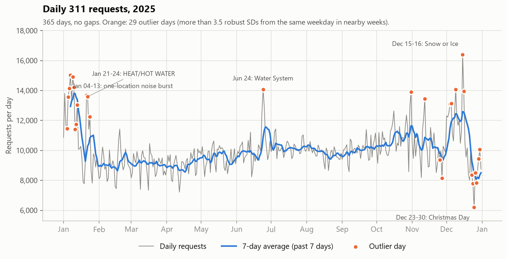

### Data checks

| Check | Result | How it's handled |
|---|---:|---:|
| Missing days | 0 of 365 days missing, 0 days with zero requests | Nothing to fix. The SQL joins counts onto a full calendar, so a missing day would show up as 0. |
| Partial first/last day | first request 2025-01-01T00:00:12, last 2025-12-31T23:59:28; 0 days missing clock hours | Both ends are complete days, so they stay in. |
| Daylight saving time | 2025-03-09 has 23 clock hours | Kept as is. Demand is counted per calendar day, which is how staff experience it. |
| Partial weeks | weeks starting 2024-12-30 and 2025-12-29 have fewer than 7 days in 2025 | Left out of weekly totals only; every day stays in the daily series. |
| Data outages | 0 empty days; the only hour with no requests is the DST hour that doesn't exist | None found. |
| Outlier days | 29 days in 10 episodes | Kept. They are real demand, and a forecast should be judged on them. |
| Single-location bursts | 124,099 requests (3.4% of the year) on 92 days, nearly all NYPD | Kept in the main series. A second series without them is used to measure how much error they cause. |

### Outlier days

A day is an outlier when it is more than 3.5 robust standard deviations away from the same
weekday in the 3 weeks before and after it (median and MAD of log(count / baseline), so the outliers
themselves don't hide). This check looks at future days, which is fine for describing the data. Its flags
are never given to a model, because a model can't know in advance that a day will be unusual.
Consecutive outlier days (gaps of up to 3 days) are grouped into episodes.

| Episode | Outlier days | Direction | Peak vs baseline | Main driver | Share of excess from hotspots |
|---|---:|---:|---:|---:|---:|
| 2025-01-04 to 2025-01-13 | 9 | high | +73.6% | Noise - Residential | 88.2% |
| 2025-01-21 to 2025-01-24 | 3 | high | +37.5% | HEAT/HOT WATER | 22.8% |
| 2025-06-24 | 1 | high | +42.9% | Water System | 0.0% |
| 2025-10-31 | 1 | high | +35.5% | Construction Safety Enforcement | 0.0% |
| 2025-11-12 | 1 | high | +31.3% | Noise - Residential | 66.6% |
| 2025-11-25 to 2025-11-27 | 2 | low | -26.7% | Thanksgiving Day | n/a |
| 2025-12-04 to 2025-12-05 | 2 | high | +30.4% | HEAT/HOT WATER | 61.6% |
| 2025-12-09 | 1 | high | +35.3% | Noise - Residential | 53.5% |
| 2025-12-15 to 2025-12-16 | 2 | high | +61.0% | Snow or Ice | 27.4% |
| 2025-12-23 to 2025-12-30 | 7 | low | -46.8% | Christmas Day | n/a |

"Main driver" is the holiday, or else the complaint type that moved furthest from its own baseline.

**Single-location bursts.** A "hotspot" here means one location (coordinates rounded to about 10 m) filing
more than 100 requests of one complaint type in a single day. The rule only uses that day's own requests, so
it could run at the end of each day with no look-ahead
([`sql/forecast/04_daily_hotspots.sql`](../../sql/forecast/04_daily_hotspots.sql)). Almost all hotspot
requests come from one spot in ZIP 10466 ([`05_hotspot_profile.sql`](../../sql/forecast/05_hotspot_profile.sql)):

- It filed 115,363 Noise - Residential complaints in 2025. Its median day
  has 0, its busiest day 4,978, and it
  went over 100 on 84 days.
- 100.0% of hotspot requests came through the mobile app, against
  21.0% for the same complaint type elsewhere: this looks like one repeated or
  automated submitter, not neighbourhood demand.
- They are not instant duplicates: median time to close was 2.06 hours
  (1.06 for the same type elsewhere), so each one was handled.

Because they were handled, they stay in the main series. With them subtracted, the total series has
11 outlier days instead of 29:
2025-01-01, 2025-01-21, 2025-01-22, 2025-06-24, 2025-10-31, 2025-11-27, 2025-12-15, 2025-12-16, 2025-12-23, 2025-12-24, 2025-12-25. Each matches a holiday, a weather-type complaint
(heat/hot water, water system, snow or ice) or the DOB batch load. The days that stop being outliers
(2025-01-04, 2025-01-05, 2025-01-06, 2025-01-07, 2025-01-09, 2025-01-10, 2025-01-11, 2025-01-12, 2025-01-13, 2025-01-24, 2025-11-12, 2025-11-25, 2025-12-04, 2025-12-05, 2025-12-09, 2025-12-26, 2025-12-27, 2025-12-29, 2025-12-30) include the low days after Christmas: their comparison weeks in early December were
inflated by bursts.

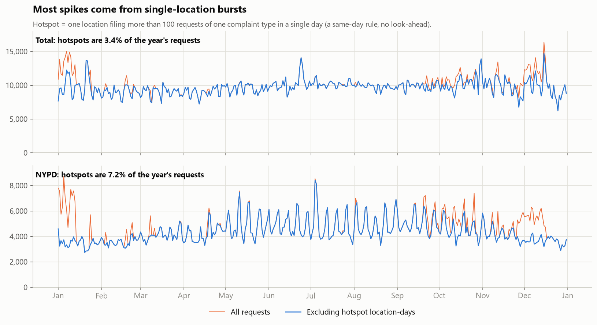

**Holidays.** 8 of 11 federal holidays were below their baseline and
3 above it, and the size differs a lot by holiday:

| Date | Holiday | vs baseline | Robust z |
|---|---:|---:|---:|
| 2025-01-01 | New Year's Day | -18.4% | -2.72 |
| 2025-01-20 | Martin Luther King Jr. Day | -7.2% | -0.97 |
| 2025-02-17 | Washington's Birthday | -5.8% | -0.76 |
| 2025-05-26 | Memorial Day | -7.0% | -0.94 |
| 2025-06-19 | Juneteenth National Independence Day | -7.9% | -1.08 |
| 2025-07-04 | Independence Day | +10.6% | +1.43 |
| 2025-09-01 | Labor Day | -9.3% | -1.28 |
| 2025-10-13 | Columbus Day | +1.1% | +0.20 |
| 2025-11-11 | Veterans Day | +9.4% | +1.28 |
| 2025-11-27 | Thanksgiving Day | -26.7% | -4.19 |
| 2025-12-25 | Christmas Day | -46.8% | -8.56 |

One year contains each holiday only once, so a model can learn an average "holiday" effect but not a
separate effect per holiday.

### Level, noise and outliers per series

"Noise" is the typical day-to-day deviation left after the weekly pattern: the robust standard deviation of
log(count / same-weekday baseline), as a percentage. It is a first hint of how hard each series will be to forecast.

| Series | Mean/day | Min | Max | Noise | Outlier days | Hotspot share | Noise excl. hotspots | Outlier days excl. hotspots |
|---|---:|---:|---:|---:|---:|---:|---:|---:|
| Total | 10,014 | 6,216 | 16,388 | 7.3% | 29 | 3.4% | 6.9% | 11 |
| NYPD | 4,706 | 2,739 | 8,711 | 11.3% | 19 | 7.2% | 8.9% | 7 |
| HPD | 2,122 | 473 | 7,127 | 16.3% | 11 | 0.0% | 16.3% | 11 |
| DSNY | 895 | 276 | 3,720 | 14.2% | 20 | 0.0% | 14.2% | 20 |
| DOT | 581 | 151 | 1,098 | 12.4% | 11 | 0.0% | 12.4% | 11 |
| DEP | 540 | 185 | 3,721 | 14.9% | 16 | 0.0% | 14.9% | 16 |

### Weekly and day-of-week patterns

Each weekday compared with the average of its own week (median over 51 complete weeks).
Dividing by the same week's average removes slow level changes and leaves only the weekly shape.

| Series | Mon | Tue | Wed | Thu | Fri | Sat | Sun |
|---|---:|---:|---:|---:|---:|---:|---:|
| Total | +4.8% | +3.8% | +1.2% | +0.8% | +1.9% | -7.1% | -7.1% |
| NYPD | -8.8% | -9.7% | -12.7% | -11.5% | +0.3% | +14.1% | +19.4% |
| HPD | +25.3% | +17.1% | +17.3% | +13.1% | +0.0% | -40.2% | -39.2% |
| DSNY | +7.2% | +14.1% | +9.7% | +9.0% | +6.9% | -23.0% | -25.3% |
| DOT | +16.9% | +23.2% | +21.5% | +18.7% | +3.3% | -40.2% | -42.1% |
| DEP | +10.3% | +15.1% | +10.6% | +9.6% | -0.4% | -20.1% | -31.3% |

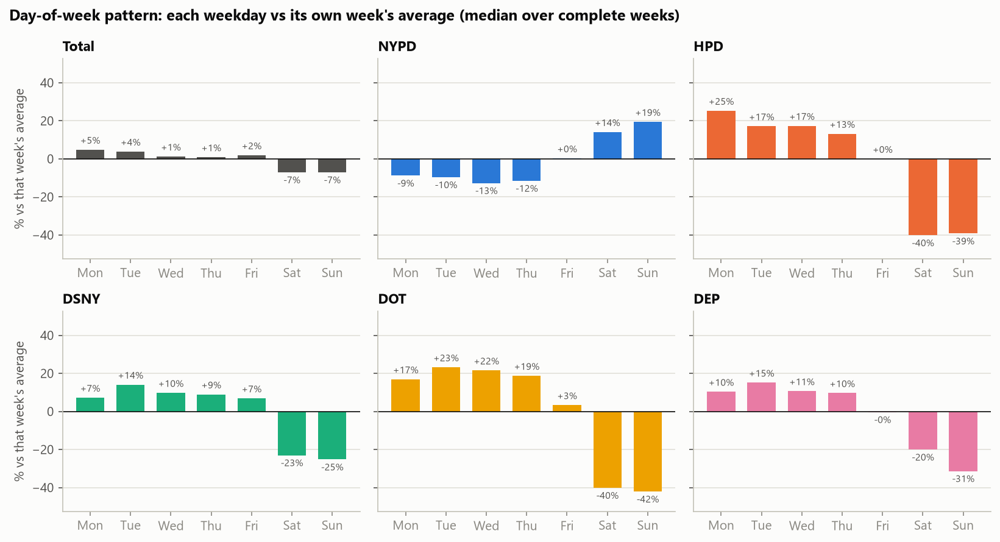

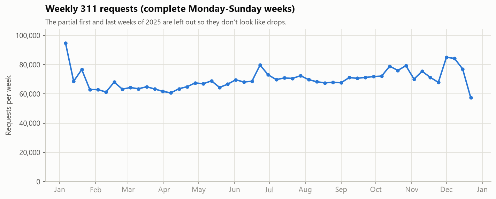

Complete weeks range from 57,403 to 94,785 requests
(mean 69,909).

### Yearly seasonality can't be learned from this data

Average requests per day in each month, compared with the year's average:

| Series | Jan | Feb | Mar | Apr | May | Jun | Jul | Aug | Sep | Oct | Nov | Dec |
|---|---:|---:|---:|---:|---:|---:|---:|---:|---:|---:|---:|---:|
| Total | +12.2% | -8.9% | -9.4% | -9.3% | -5.0% | +2.0% | +1.8% | -2.1% | +0.8% | +8.4% | +1.5% | +7.0% |
| NYPD | +5.0% | -20.9% | -10.8% | -9.5% | +3.9% | +5.0% | +2.7% | +5.7% | +11.3% | +8.9% | -1.0% | -2.2% |
| HPD | +68.2% | +25.5% | -5.8% | -19.7% | -36.2% | -35.7% | -33.1% | -39.1% | -33.0% | +13.4% | +35.5% | +60.9% |
| DSNY | -5.0% | -13.5% | -8.8% | +9.8% | +3.6% | +10.4% | +16.9% | +9.3% | +9.1% | -7.8% | -24.2% | -1.0% |
| DOT | -7.9% | +9.6% | +6.2% | +4.2% | +6.5% | +13.1% | +2.4% | -3.8% | -0.4% | -3.2% | -16.7% | -8.9% |
| DEP | -8.3% | -13.6% | -18.5% | -21.4% | -17.3% | +50.7% | +50.2% | +15.1% | -4.5% | +6.6% | -15.2% | -24.7% |

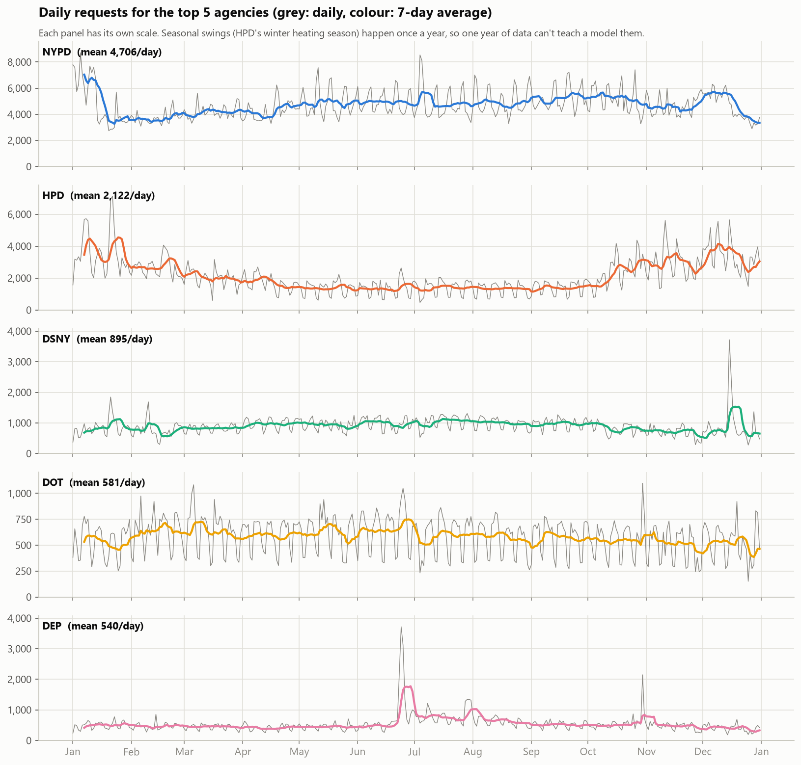

Some series have large seasonal swings, for example HPD (heating complaints) runs +68.2% in January and -39.1% in August.
With one year of data, each season is seen exactly once, so no model here can learn "January is high"
as a repeating pattern: there is no earlier January to learn it from. The models in later phases can only
follow the level of the last few weeks (they adapt when the season changes, but with a lag) and the weekly
pattern, which repeats 52 times. Learning yearly seasonality would need at least two or three years of data.

## Phase 2: Baselines and backtest design

Code: [`forecast/backtest.py`](../../forecast/backtest.py) (backtest engine, metrics) and
[`forecast/baselines.py`](../../forecast/baselines.py).

### Backtest design

Rolling origin: at each cutoff the model gets every day up to and including the cutoff, forecasts the
next 14 days, and is scored on what happened. The cutoff then moves forward 7 days.
The engine cuts the series at the cutoff *before* calling the model, so no model can see the days it forecasts.

- **Validation cutoffs** (9): 2025-08-13 to 2025-10-08. Phase 3 chooses model settings on these.
- **Test cutoffs** (9): 2025-10-22 to 2025-12-17, forecasting 2025-10-23 to 2025-12-31,
  the last ~10 weeks. Reported only, never used to choose anything.
- No day is forecast in both sets. Windows within a set overlap (14-day windows, 7-day steps), so most days are
  forecast twice, once 1-7 days ahead and once 8-14 days ahead. All cutoffs are Wednesdays.
- Metrics are pooled over all 14 x 9 = 126 forecasts per model:
  **MAE** (average miss in requests/day), **RMSE** (like MAE but large misses count extra) and **MAPE**
  (average miss as a % of the actual). "vs seasonal naive" = % lower error than seasonal naive (positive is better).

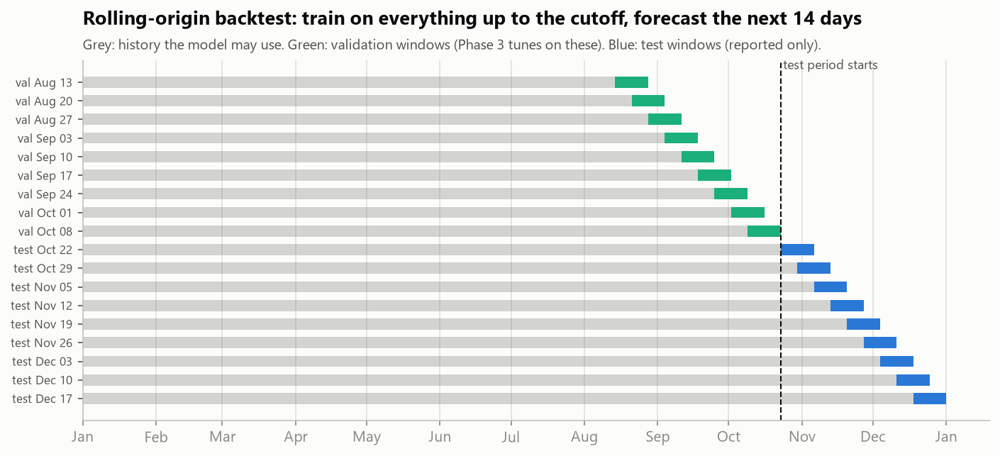

### Baselines

- **Naive:** every future day = the last observed day.
- **Seasonal naive:** each future day = the same weekday in the last observed week.
- **4-week same-weekday average:** each future day = the mean of the last 4 observed same weekdays.

### Results: Total, test windows

| Model | MAE | RMSE | MAPE | MAE vs seasonal naive | RMSE vs seasonal naive | MAPE vs seasonal naive |
|---|---:|---:|---:|---:|---:|---:|
| Naive (tomorrow = today) | 1,847 | 2,284 | 17.9% | +1.6% | +4.0% | +2.8% |
| Seasonal naive (same weekday last week) | 1,877 | 2,378 | 18.4% | +0.0% | +0.0% | +0.0% |
| 4-week same-weekday average | 1,533 | 1,868 | 14.9% | +18.3% | +21.4% | +19.2% |

Excluding single-location bursts (hotspots removed from both history and actuals):

| Model | MAE | RMSE | MAPE | MAE vs seasonal naive | RMSE vs seasonal naive | MAPE vs seasonal naive |
|---|---:|---:|---:|---:|---:|---:|
| Naive (tomorrow = today) | 1,464 | 1,842 | 15.1% | -7.3% | -1.7% | -7.2% |
| Seasonal naive (same weekday last week) | 1,364 | 1,811 | 14.1% | +0.0% | +0.0% | +0.0% |
| 4-week same-weekday average | 1,083 | 1,454 | 11.2% | +20.6% | +19.7% | +20.3% |

### Results: Total, validation windows

| Model | MAE | RMSE | MAPE | MAE vs seasonal naive | RMSE vs seasonal naive | MAPE vs seasonal naive |
|---|---:|---:|---:|---:|---:|---:|
| Naive (tomorrow = today) | 705 | 877 | 6.8% | -23.1% | -17.8% | -21.7% |
| Seasonal naive (same weekday last week) | 573 | 744 | 5.6% | +0.0% | +0.0% | +0.0% |
| 4-week same-weekday average | 527 | 686 | 5.1% | +8.0% | +7.9% | +9.0% |

The test period is much harder than validation: seasonal naive has an MAE of 1,877 on test
against 573 on validation. The last 10 weeks of 2025 contain the outlier episodes from
Phase 1 (bursts, Thanksgiving, the December snow, Christmas) and the start of the heating season, while
mid-August to mid-October was calm.

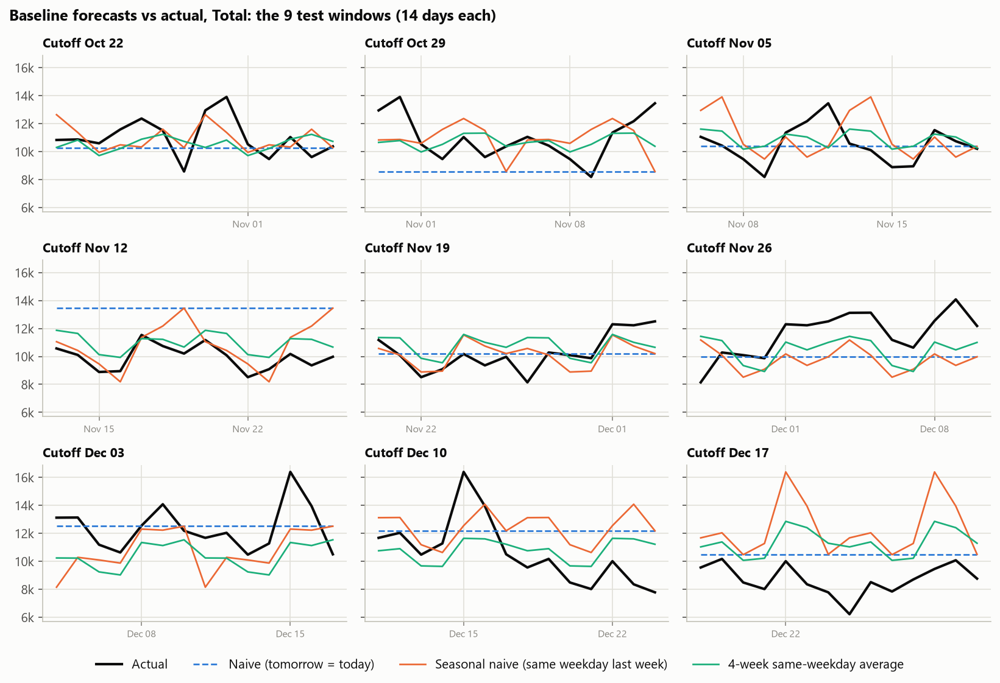

**MAE per test window (Total, as recorded):**

| Cutoff | Naive (tomorrow = today) | Seasonal naive (same weekday last week) | 4-week same-weekday average | Best |
|---|---:|---:|---:|---:|
| 2025-10-22 | 1,189 | 1,080 | 1,154 | Seasonal naive (same weekday last week) |
| 2025-10-29 | 2,476 | 1,721 | 1,183 | 4-week same-weekday average |
| 2025-11-05 | 1,055 | 1,700 | 1,049 | 4-week same-weekday average |
| 2025-11-12 | 3,497 | 1,199 | 1,044 | 4-week same-weekday average |
| 2025-11-19 | 1,000 | 956 | 1,110 | Seasonal naive (same weekday last week) |
| 2025-11-26 | 1,893 | 2,256 | 1,707 | 4-week same-weekday average |
| 2025-12-03 | 1,305 | 1,926 | 2,126 | Naive (tomorrow = today) |
| 2025-12-10 | 2,416 | 2,432 | 1,812 | 4-week same-weekday average |
| 2025-12-17 | 1,791 | 3,619 | 2,612 | Naive (tomorrow = today) |

Windows won: Naive (tomorrow = today) 2, Seasonal naive (same weekday last week) 2, 4-week same-weekday average 5. Copying one day or one week copies whatever
happened on it: after the 2025-12-15 snowstorm, seasonal naive predicted another storm-sized day a week later.
Averaging 4 weeks dilutes one-off events, which is why it wins on average.

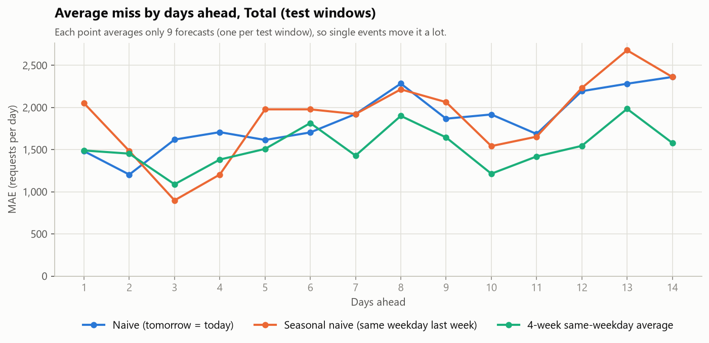

### All series: MAPE by baseline

| Series | Val. naive | Val. seas. naive | Val. 4-wk avg | Test naive | Test seas. naive | Test 4-wk avg |
|---|---:|---:|---:|---:|---:|---:|
| Total | 6.8% | 5.6% | 5.1% | 17.9% | 18.4% | 14.9% |
| Total (excl. hotspots) | 6.3% | 5.8% | 4.6% | 15.1% | 14.1% | 11.2% |
| NYPD | 20.6% | 10.4% | 8.6% | 19.2% | 19.4% | 20.1% |
| NYPD (excl. hotspots) | 17.6% | 9.4% | 8.2% | 10.5% | 8.9% | 9.1% |
| HPD | 39.9% | 17.2% | 15.1% | 36.2% | 31.0% | 24.2% |
| DSNY | 22.0% | 14.0% | 13.2% | 39.3% | 40.0% | 27.2% |
| DOT | 41.9% | 13.8% | 11.6% | 47.3% | 21.5% | 19.7% |
| DEP | 24.2% | 14.6% | 18.5% | 31.2% | 29.5% | 29.1% |

### The bar for Phase 3

The best baseline for Total on **validation** is **4-week same-weekday average** (MAE 527,
+8.0% vs seasonal naive). On test, the best baseline is
4-week same-weekday average (MAE 1,533, +18.3%).
A Phase 3 model has to beat seasonal naive (the required reference) *and* this stronger baseline before it is
worth using. The bar was chosen on validation, not test.

## Phase 3: Models

Code: [`forecast/models.py`](../../forecast/models.py) (models, features, intervals) and
[`forecast/evaluate_models.py`](../../forecast/evaluate_models.py) (tuning, comparison, intervals).
Series: Total. Same backtest and cutoffs as Phase 2.

### The two models

**Holt-Winters (exponential smoothing), chosen over SARIMA.** It tracks three things: the current level,
an optional (damped) trend and a 7-day pattern, each updated with a smoothing weight that decides how fast old
data is forgotten. SARIMA would need an order search over (p,d,q)(P,D,Q) with little data per fit (64 days for the
earliest interval-calibration cutoff, 351 for the last test cutoff), and its parameters are harder to explain. Holt-Winters has a handful of settings and adapts to level shifts on its own.
*No leakage:* it is fitted at each cutoff on `history`, which ends at the cutoff.

**Gradient boosting, direct multi-step strategy.** One scikit-learn `HistGradientBoostingRegressor` per cutoff,
trained on every (origin day t, horizon h) pair in the history, predicting day t+h from what was known on day t:

- calendar of the target day: day of week, month, US federal holiday (the `holidays` package; known years ahead)
- horizon h (1-14)
- `lag_7`, `lag_14`: the most recent and second most recent same weekday observed by day t. For h = 1-7 these are
  exactly 7 and 14 days before the target. For h = 8-14 the day 7 before the target hasn't happened yet, so they
  are 14 and 21 days before. They are always the latest values that actually exist at the origin.
- `roll_7`: mean of the 7 days ending at t.

*Why direct, not recursive:* a recursive model forecasts tomorrow, feeds that guess back in as a lag and repeats 14
times, so its errors compound and a spike gets copied forward again and again. The direct model never uses a
prediction as an input. *No leakage:* a training row is only used if its target day is on or before the cutoff
(checked with an `assert`), and the features of a row only read values up to its origin. Two tests prove it by
rewriting or multiplying every value after the cutoff and checking the forecast doesn't change.

### Tuning (validation cutoffs only)

| Model | Setting | Validation MAE | Validation MAPE |
|---|---:|---:|---:|
| Holt-Winters | add weekly season, no trend, all history | 616 | 6.0% |
| Holt-Winters | add weekly season, no trend, last 12 weeks | 560 | 5.5% |
| Holt-Winters | mul weekly season, no trend, all history | 634 | 6.2% |
| Holt-Winters | mul weekly season, no trend, last 12 weeks | 582 | 5.7% |
| Holt-Winters | add weekly season, damped trend, all history | 531 | 5.2% |
| Holt-Winters | add weekly season, damped trend, last 12 weeks | 568 | 5.6% |
| Holt-Winters | mul weekly season, damped trend, all history | 632 | 6.2% |
| Holt-Winters | mul weekly season, damped trend, last 12 weeks | 578 | 5.7% |
| Gradient boosting | absolute target, depth 2, learning rate 0.03 | 514 | 5.0% |
| Gradient boosting | absolute target, depth 2, learning rate 0.1 | 499 | 4.9% |
| Gradient boosting | absolute target, depth 4, learning rate 0.03 | 489 | 4.8% |
| Gradient boosting | absolute target, depth 4, learning rate 0.1 | 544 | 5.3% |
| Gradient boosting | relative target, depth 2, learning rate 0.03 | 518 | 5.0% |
| Gradient boosting | relative target, depth 2, learning rate 0.1 | 510 | 4.9% |
| Gradient boosting | relative target, depth 4, learning rate 0.03 | 480 | 4.7% |
| Gradient boosting | relative target, depth 4, learning rate 0.1 | 478 | 4.6% |

Chosen: Holt-Winters with add weekly season, damped trend, all history; gradient boosting with
relative target, depth 4, learning rate 0.1. "Relative target" means the model predicts the ratio to the last
7-day mean instead of a raw count, so it can follow a level it never saw in training.

### Model comparison (Total, same backtest for every model)

As recorded:

| Model | Val. MAE | Val. MAE vs seas. naive | Test MAE | Test RMSE | Test MAPE | Test MAE vs seas. naive | Test RMSE vs seas. naive | Test MAPE vs seas. naive |
|---|---:|---:|---:|---:|---:|---:|---:|---:|
| Naive (tomorrow = today) | 705 | -23.1% | 1,847 | 2,284 | 17.9% | +1.6% | +4.0% | +2.8% |
| Seasonal naive (same weekday last week) | 573 | +0.0% | 1,877 | 2,378 | 18.4% | +0.0% | +0.0% | +0.0% |
| 4-week same-weekday average | 527 | +8.0% | 1,533 | 1,868 | 14.9% | +18.3% | +21.4% | +19.2% |
| Holt-Winters (tuned) | 531 | +7.3% | 1,745 | 2,177 | 17.4% | +7.0% | +8.4% | +5.6% |
| Gradient boosting (tuned) | 478 | +16.5% | 1,765 | 2,278 | 17.3% | +6.0% | +4.2% | +6.2% |

Excluding hotspots:

| Model | Val. MAE | Val. MAE vs seas. naive | Test MAE | Test RMSE | Test MAPE | Test MAE vs seas. naive | Test RMSE vs seas. naive | Test MAPE vs seas. naive |
|---|---:|---:|---:|---:|---:|---:|---:|---:|
| Naive (tomorrow = today) | 624 | -10.4% | 1,464 | 1,842 | 15.1% | -7.3% | -1.7% | -7.2% |
| Seasonal naive (same weekday last week) | 566 | +0.0% | 1,364 | 1,811 | 14.1% | +0.0% | +0.0% | +0.0% |
| 4-week same-weekday average | 449 | +20.6% | 1,083 | 1,454 | 11.2% | +20.6% | +19.7% | +20.3% |
| Holt-Winters (tuned) | 508 | +10.1% | 1,321 | 1,655 | 13.9% | +3.1% | +8.6% | +1.2% |
| Gradient boosting (tuned) | 422 | +25.4% | 1,342 | 1,738 | 13.9% | +1.6% | +4.0% | +1.3% |

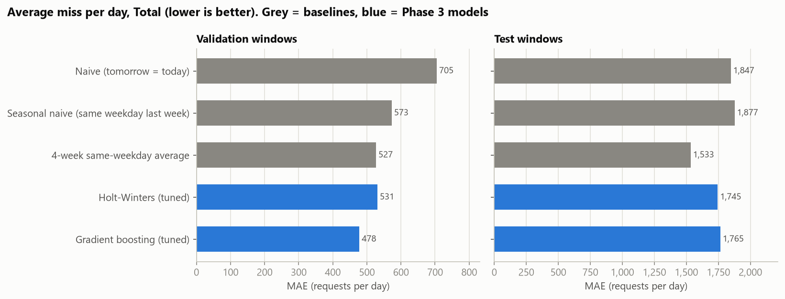

**Honest reading:**

- On validation, Gradient boosting (tuned) is best (MAE 478, +16.5% vs
  seasonal naive), so it is the model chosen for the rest of the project.
- On test, both tuned models still beat seasonal naive (Gradient boosting (tuned): +6.0%
  MAE), but **neither beats the 4-week same-weekday average**. The best test MAE is 4-week same-weekday average
  (1,533). The validation period (mid-August to mid-October) was calm, so the model choice
  that won there didn't carry over to a volatile November and December. I did not re-tune or switch models after
  seeing this, since that would be tuning on the test set.

### Where the test error comes from

Each test forecast is put in one of three groups: the day was a Phase 1 outlier day (27 forecasts),
one of its lag days was an outlier day so the event could be copied (17), or neither
(82). Outlier flags are used here only to diagnose errors after the fact.

| Model | MAE normal | MAE copied event | MAE event day | Error share normal | Error share copied | Error share event day |
|---|---:|---:|---:|---:|---:|---:|
| Naive (tomorrow = today) | 1,616 | 1,554 | 2,731 | 57.0% | 11.4% | 31.7% |
| Seasonal naive (same weekday last week) | 1,222 | 2,530 | 3,452 | 42.4% | 18.2% | 39.4% |
| 4-week same-weekday average | 1,073 | 1,288 | 3,086 | 45.5% | 11.3% | 43.1% |
| Holt-Winters (tuned) | 1,282 | 1,789 | 3,124 | 47.8% | 13.8% | 38.4% |
| Gradient boosting (tuned) | 1,199 | 2,057 | 3,302 | 44.2% | 15.7% | 40.1% |

- Outlier days are a fifth of the test forecasts but account for about 40% of every model's error. No model that
  only sees the past could have predicted a snowstorm or a filing burst.
- Single lags copy events: on "copied event" days, models that lean on one recent week (seasonal naive, gradient
  boosting) do much worse than the 4-week average, which dilutes a one-off spike four ways. In the chart below,
  the 2025-12-15 snow spike reappears in the forecasts a week and two weeks later.
- Even on normal days the 4-week average is lowest on test, so the models also struggle with the level shift
  into the heating season and the holiday period.

**MAE per test window:**

| Cutoff | Naive (tomorrow = today) | Seasonal naive (same weekday last week) | 4-week same-weekday average | Holt-Winters (tuned) | Gradient boosting (tuned) | Best |
|---|---:|---:|---:|---:|---:|---:|
| 2025-10-22 | 1,189 | 1,080 | 1,154 | 1,005 | 1,155 | Holt-Winters (tuned) |
| 2025-10-29 | 2,476 | 1,721 | 1,183 | 1,375 | 1,502 | 4-week same-weekday average |
| 2025-11-05 | 1,055 | 1,700 | 1,049 | 884 | 1,052 | Holt-Winters (tuned) |
| 2025-11-12 | 3,497 | 1,199 | 1,044 | 2,421 | 900 | Gradient boosting (tuned) |
| 2025-11-19 | 1,000 | 956 | 1,110 | 975 | 905 | Gradient boosting (tuned) |
| 2025-11-26 | 1,893 | 2,256 | 1,707 | 2,207 | 2,170 | 4-week same-weekday average |
| 2025-12-03 | 1,305 | 1,926 | 2,126 | 930 | 1,565 | Holt-Winters (tuned) |
| 2025-12-10 | 2,416 | 2,432 | 1,812 | 2,437 | 3,034 | 4-week same-weekday average |
| 2025-12-17 | 1,791 | 3,619 | 2,612 | 3,473 | 3,604 | Naive (tomorrow = today) |

Windows won: Naive (tomorrow = today) 1, Seasonal naive (same weekday last week) 0, 4-week same-weekday average 3, Holt-Winters (tuned) 3, Gradient boosting (tuned) 2.

### 80% prediction intervals (Gradient boosting (tuned))

Method (empirical intervals, no distribution assumed): for each cutoff, take the model's own forecasts from every
earlier weekly window that had *finished* by that cutoff, compute actual / forecast, and use its 10th and 90th
percentiles, separately for 1-7 and 8-14 days ahead. The interval is the forecast times those two ratios. Only
errors that were known at the cutoff are used, so the interval has no look-ahead either. The weekly windows
start on 2025-03-05.

| Variant, split | Coverage | 1-7 days | 8-14 days | Actual below | Actual above | Mean width | Width % of forecast | Min. past windows |
|---|---:|---:|---:|---:|---:|---:|---:|---:|
| as recorded, validation | 88.1% | 87.3% | 88.9% | 5.6% | 6.3% | 1,989 | 19.9% | 22 |
| as recorded, test | 40.5% | 47.6% | 33.3% | 34.1% | 25.4% | 2,288 | 20.8% | 32 |
| excl hotspots, validation | 84.9% | 87.3% | 82.5% | 10.3% | 4.8% | 1,805 | 18.3% | 22 |
| excl hotspots, test | 46.0% | 49.2% | 42.9% | 36.5% | 17.5% | 1,973 | 19.1% | 32 |

**Target 80%. Validation: 88.1%, close to the target.
Test: 40.5%: the intervals are far too narrow for the test period.** They are about
21% of the forecast wide because they learned from mostly calm months. Misses go
both ways: 34.1% of test days came in below the interval (holidays, and the weeks after the
snow spike) and 25.4% above it (bursts, the snow, the early-December rise). An interval
built from past errors can only be as wide as the past was rough. The fix is a longer history that includes
earlier holiday seasons, or explicit event adjustments, not a re-calibration on the test weeks.

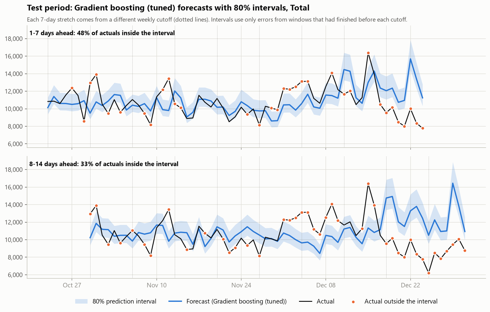

## Phase 4: Per-agency forecasts

Code: [`forecast/agencies.py`](../../forecast/agencies.py). Same backtest, cutoffs and interval method as Phase 3.

**Approach.** For each agency, four candidates are backtested: seasonal naive, the 4-week same-weekday average,
Holt-Winters (add weekly season, damped trend, all history) and gradient boosting (relative target, depth 4, learning rate 0.1), with
the settings tuned on the total series in Phase 3. Each agency gets the candidate with the lowest MAE on **its own
validation windows**. Test windows are only used to report results. The settings were not re-tuned per agency:
9 validation windows per agency are too few to tune 16 settings without overfitting.

### Results (sorted from easiest to hardest to forecast)

| Agency | Chosen (validation) | Val. MAPE | Test MAE | Test MAPE | Test MAE vs seas. naive | 80% interval coverage (test) |
|---|---:|---:|---:|---:|---:|---:|
| DOT | 4-week avg | 11.6% | 90 | 19.7% | +12.2% | 69.8% |
| NYPD | 4-week avg | 8.6% | 887 | 20.1% | -4.7% | 42.1% |
| DEP | Holt-Winters | 14.2% | 104 | 20.4% | +28.2% | 77.8% |
| HPD | Gradient boosting | 14.8% | 894 | 31.2% | +3.0% | 57.1% |
| DSNY | Gradient boosting | 10.7% | 300 | 39.5% | +4.4% | 61.1% |

Test MAPE of every candidate (* = the one chosen on validation):

| Agency | Seasonal naive | 4-week avg | Holt-Winters | Gradient boosting | Best on test |
|---|---:|---:|---:|---:|---:|
| DOT | 21.5% | 19.7% * | 18.3% | 17.0% | Gradient boosting |
| NYPD | 19.4% | 20.1% * | 18.6% | 20.6% | Holt-Winters |
| NYPD (excl. hotspots) | 8.9% | 9.1% | 9.3% * | 8.9% | Gradient boosting |
| DEP | 29.5% | 29.1% | 20.4% * | 26.3% | Holt-Winters |
| HPD | 31.0% | 24.2% | 33.5% | 31.2% * | 4-week avg |
| HPD (excl. hotspots) | 31.0% | 24.2% | 33.8% | 31.9% * | 4-week avg |
| DSNY | 40.0% | 27.2% | 41.3% | 39.5% * | 4-week avg |

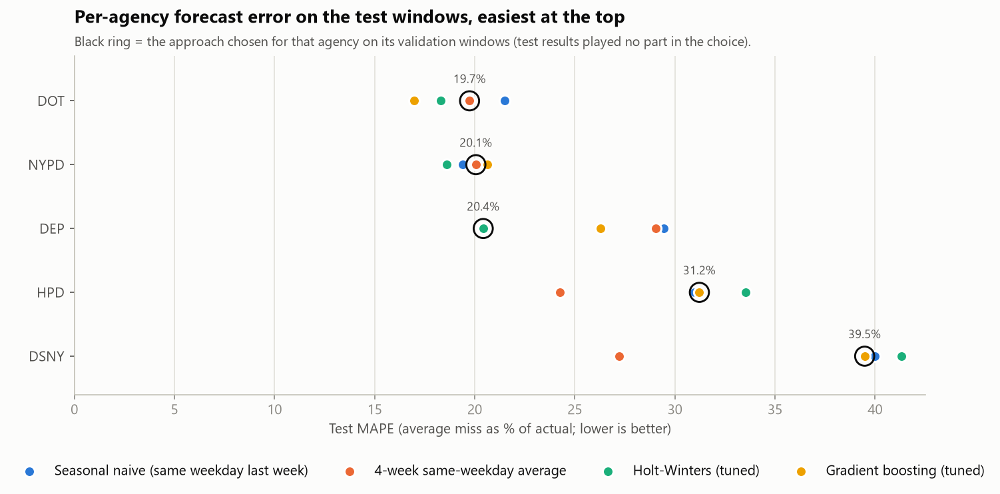

For 4 of 5 agencies, a different candidate would have done better on test than the one validation
picked. With only 9 calm validation windows per agency, the choice is noisy. Validation picked gradient boosting
for HPD and DSNY; on test it copied event spikes forward and lagged behind rising levels, and the 4-week
average, which spreads a single event over four weeks, was best there (HPD and DSNY). Elsewhere the
differences on test are a few points of MAPE. No choice was changed after seeing the test results.

### Why some agencies are easier than others

| Agency | Test MAPE | Day-to-day noise | Weekday swing | Level change Oct to Dec | Hotspot share | Outlier days in test period | Error on event days | Error on copied events |
|---|---:|---:|---:|---:|---:|---:|---:|---:|
| DOT | 19.7% | 12.4% | 65 pts | -6 pts | 0.0% | 4 | 29.8% | 3.6% |
| NYPD | 20.1% | 11.3% | 32 pts | -11 pts | 7.2% | 5 | 9.0% | 4.6% |
| DEP | 20.4% | 14.9% | 46 pts | -31 pts | 0.0% | 6 | 38.3% | 8.0% |
| HPD | 31.2% | 16.3% | 66 pts | +48 pts | 0.0% | 4 | 12.7% | 6.4% |
| DSNY | 39.5% | 14.2% | 39 pts | +7 pts | 0.0% | 10 | 45.7% | 21.9% |

What each agency's test period was made of
([`sql/forecast/06_agency_test_drivers.sql`](../../sql/forecast/06_agency_test_drivers.sql)):

| Agency | Largest complaint type | Busiest test day | Requests that day | Largest type that day |
|---|---:|---:|---:|---:|
| DOT | Street Condition (28%) | 2025-10-30 | 1,098 | Traffic Signal Condition (597) |
| NYPD | Noise - Residential (35%) | 2025-10-26 | 7,408 | Noise - Residential (3,715) |
| DEP | Noise (32%) | 2025-10-30 | 2,148 | Sewer (1,695) |
| HPD | HEAT/HOT WATER (58%) | 2025-12-15 | 5,653 | HEAT/HOT WATER (3,569) |
| DSNY | Dirty Condition (17%) | 2025-12-15 | 3,720 | Snow or Ice (3,296) |

- **DOT** (19.7%): the strongest and most regular weekly cycle (65-point swing between its busiest and quietest weekday: street and traffic-signal work follows business days), a stable level (-6 points Oct to Dec) and few events.
- **NYPD** (20.1%): its error is mostly the single-location noise bursts (7.2% of its requests). With bursts removed, the chosen model's test MAPE drops to 9.3%, which would make NYPD the easiest agency of all.
- **DEP** (20.4%): mostly calm, but one-day events dominate: 38.3% of its error falls on its own outlier days. Its busiest test day (2025-10-30) was 1,695 Sewer complaints, the pattern of a heavy-rain day (no weather data is used here to confirm it).
- **HPD** (31.2%): the heating season. HEAT/HOT WATER is 58% of HPD's test-period requests, and HPD's level climbs +48 points from October to December. 81.0% of the error is on ordinary days, so it comes from chasing a rising level, not from events. One year of data has only one heating season to learn from.
- **DSNY** (39.5%): the December snow. Its busiest day (2025-12-15) had 3,720 requests, 3,296 of them Snow or Ice. Event days carry 45.7% of the error and copied events another 21.9%: gradient boosting repeated the snow spike in the following week's forecast.

In short: **DOT is easiest** because its demand follows the working week, and **DSNY is hardest** because
events, led by the December snow, cause 67.6% of its error (on event days plus copied
events). A model that only knows the calendar and the past can't see a storm coming; a weather forecast as an
input is the most promising addition for DSNY and DEP.

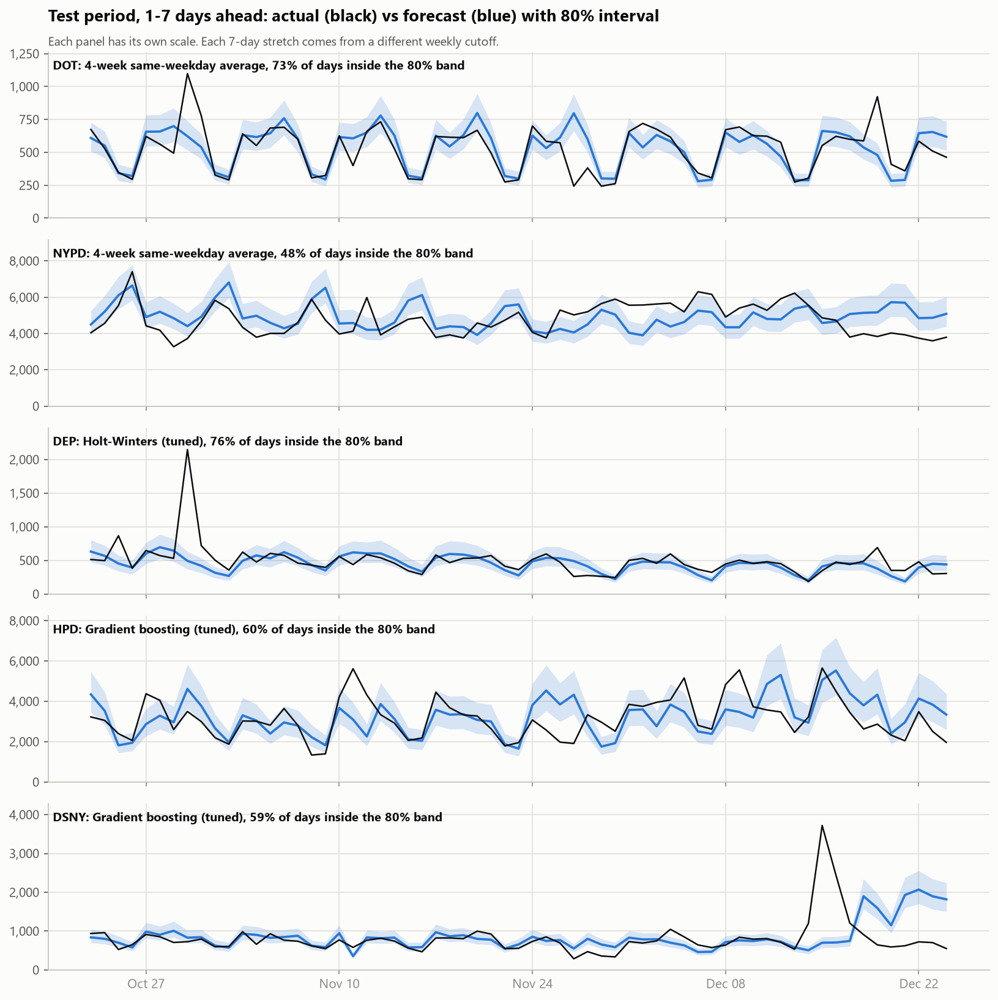

### From forecasts to staffing

A forecast says how many requests to *expect*; a staffing plan has to decide how many to *cover*. That is the same
question a supply chain team answers with safety stock. Two rostering policies, measured on the test days:

- **Roster to the forecast:** no buffer. If the forecast is unbiased, expect to be short on roughly half of all days.
- **Roster to the P90** (the top of the 80% interval): a buffer sized from the model's own past errors. It should
  be short on about 10% of days, the staffing version of a 90% service level.

| Agency | Avg requests/day (test) | P90 buffer above forecast | Short days: forecast plan | Avg shortfall when short | Short days: P90 plan | Avg shortfall when short (P90) | Avg spare capacity (P90) |
|---|---:|---:|---:|---:|---:|---:|---:|
| DOT | 523 | +16.4% | 43.7% | 93 | 15.1% | 130 | 135 |
| NYPD | 4,698 | +18.2% | 38.1% | 862 | 19.8% | 430 | 1,512 |
| DEP | 477 | +31.7% | 52.4% | 125 | 13.5% | 241 | 171 |
| HPD | 3,155 | +32.4% | 42.9% | 801 | 15.9% | 540 | 1,655 |
| DSNY | 792 | +21.3% | 37.3% | 329 | 13.5% | 680 | 379 |
| HPD (excl. hotspots) | 3,155 | +29.5% | 42.9% | 829 | 18.3% | 603 | 1,612 |
| NYPD (excl. hotspots) | 3,973 | +13.7% | 36.5% | 199 | 2.4% | 116 | 810 |

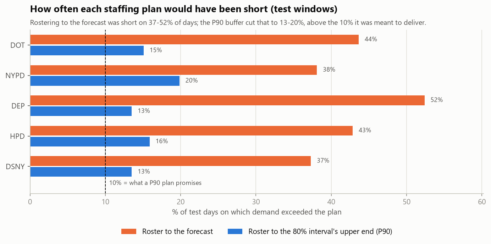

The P90 plan cut short days sharply for every agency, but it never reached the 10% it promised: the buffers were
sized on calm months (Phase 3). How a team would use this:

1. **Roster by weekday, not by week.** The weekly shape (Phase 1) is the most reliable signal there is.
   DOT gets 41%, HPD gets 40% fewer requests on an average weekend day than
   its weekly average, while NYPD gets 17% more. A flat roster
   wastes capacity on some days and is short on others.
2. **Pick the service level per agency from the cost of being short.** If an unanswered request costs much more
   than an idle hour (for example, no heat in winter), plan above P90; if not, plan nearer the forecast. This is
   the newsvendor trade-off from inventory planning: buffer = cost of shortage vs cost of excess.
3. **Publish rosters on the 14-day horizon, adjust on the 1-7-day one.** Errors grow with horizon (Phase 2), so lock
   in the next two weeks with the P90 plan and keep a small on-call pool for the near-term changes.
4. **Keep event playbooks outside the model.** Snow (DSNY), heavy rain (DEP sewer complaints), holidays and filing
   bursts (NYPD) caused most of the misses. A trigger such as a snow forecast or a burst detected by the same-day
   hotspot rule should switch to a surge plan, like a supplier-disruption plan in a supply chain.
5. **Track interval coverage every week.** When actual demand lands outside the P90 more than about 10% of the time,
   the buffer is too thin: widen it, or recalibrate on a longer history that includes a previous winter.
